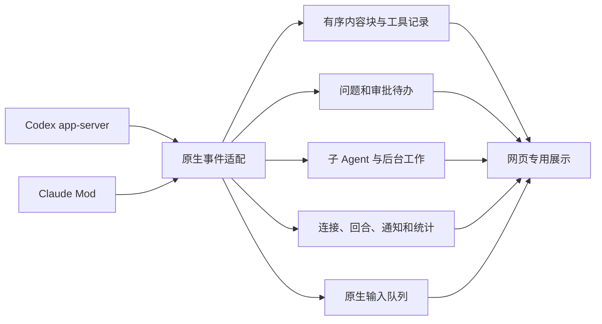

# Agent 网页事件、类型与展示口径逐项对照

日期：2026-11-27。审计对象：sTerm 0.2.7（工作区基线 286bd58）、codeg-main 0.49.0 源码。本地协议依据为前轮保留的 Codex CLI 0.170.0 experimental app-server 类型、Claude Code 2.1.322 Mod 类型。

本轮交付为分析文档：不修改业务代码、配置或测试，不操作运行中的应用。本报告是静态源码与协议声明核对，没有把前轮测试结果当成本轮逐事件实测；没有逐项触发真实 CLI。codeg 是参考项目，其 ACP 事件与 sTerm 的 app-server/Mod 事件属于不同协议层，不能按同名或相似名称直接认定能力等价。

## 1. 统一结论与审计范围

sTerm 已有主要操作闭环；当前不足集中在内容分块、结构化展示、原生增量接收、状态语义、后台工作观测和时间元数据。已有 JSON 卡片只代表收到了部分信息，不代表完整渲染；没有专用网页组件的内部通知，也不都意味着缺功能。

| 对照对象 | 数量 | 本报告位置 |
| --- | ---: | --- |
| Codex ThreadItem | 19 | 第 3 节，T01–T19 |
| Codex ServerNotification | 88 | 第 4 节，N01–N88 |
| Codex ServerRequest | 11 | 第 5 节，R01–R11 |
| Codex UserInput | 7 | 第 6 节，U01–U07 |
| Claude turn.step chunk | 6 | 第 7 节，C01–C06 |
| Claude EngineEventOf | 64 | 第 8 节，E01–E64 |
| Claude classic Hook | 34 | 第 9 节，H01–H34 |
| codeg AcpEvent | 53 | 第 10 节，G01–G53 |

合计 282 行对照。同一语义会出现在协议、适配和展示等不同层，282 不是独立产品功能数量，也不用于计算覆盖率。Claude 还有 80 个 OpEventOf 操作 Hook、插件自定义 noun 事件及开放的 API 内容块；它们不是一个固定的“会话应渲染事件”集合。本报告在第 7、8 节补充相关公开观察点，不宣称穷尽所有插件/未来版本。

当前 Codex 19 种条目只映射了 11 种，另 8 种直接略过；88 个通知有 13 个显式处理分支，其中仍有字段丢失和主/子线程处理差异。当前 Claude 的 6 类 turn.step chunk 只有 text 被转换成网页事件；engine 等底层块不应被强行转为可见消息。

### 状态与级别

- **已接入**：源码存在接收和转换路径；不等于本轮实测通过。
- **部分**：路径存在，但字段、身份、增量、历史或展示有缺失。
- **未接入**：未发现当前 adapter 的对应处理分支。
- **P0**：修正顺序、交互决议、状态或时间基础，避免用户误判。
- **P1**：补常见内容、后台工作、进度、用量与可读展示。
- **P2**：次要元信息、目标/技能等增强。
- **条件 / 边界**：需要真实来源、宿主实现或能力协商；不能仅新增网页组件就承诺支持。
- **宿主 / 兼容 / 后置**：明确处理归属或暂不开放，不计作默认聊天渲染缺陷。

各表“codeg 对应或参考”只说明在该源码中找到的等价展示能力/状态模型；不表示 codeg 对当前 Codex 原生版本的每个同项事件均端到端覆盖。标记“未核实”的项不据此宣称 codeg 支持。

## 2. 先统一对象与数据流

| 对象 | 统一含义 | 不能混用的概念 |
| --- | --- | --- |
| Session / connection | 当前共享会话、原生绑定及连接可用性 | 网页断线、Agent 断线和回合失败 |
| Turn | 一次原生处理回合，拥有开始/结束、结果、耗时和用量 | idle、成功完成、后台任务全部完成 |
| Content block | 文字、公开思考、图片、计划等有序内容 | 整个回合的所有文字拼成一块 |
| Tool call | 一次具体工具调用及其局部更新/结果 | 启动后台任务的调用已返回、后台任务已退出 |
| Interaction | 有原生身份、可回答动作及阻塞属性的待办 | 普通通知、队列、自动审查状态 |
| Background work | 子 Agent、shell、workflow、monitor、自主 turn 等各自生命周期 | 所有 work 都叫子 Agent；任务 ID 都当操作系统 PID |
| Queue | 原生接受且可查询的待执行输入 | 普通追加、steer/feedback、异步问题 |
| Notice / activity | 当前进展或一次通知 | 把每个 progress tick 追加成一条聊天消息 |

所有对象至少保留 runtime/session/generation、provider、原生对象 ID、turnId、agentId/parentId（存在时）。跨会话、跨连接的 handle 不能仅凭数值相同或命令文本相似就合并；原生归属不明确时显示未知，不猜父子关系。

快照、完整对象替换、局部字段更新和文本追加必须分别解释。codeg 的 async_task 是部分字段更新，不能照搬为 sTerm 当前 Task 的整行覆盖；缺字段表示未变更，不自动清空。已有 seq 去重与缺口补快照应继续适用于新增数据，内容 ID、排序和待办身份在实时、完成、刷新与重连之间保持一致。

## 3. Codex 会话条目逐项对照

依据：ThreadItem.ts、sTerm codex.rs 的 item()、codeg ContentBlock/活动类型。条目类别齐全还不够，同一类别中的结构化字段也必须保留。

| 编号 | 事件 / 类型 | sTerm 当前处理 | codeg 对应或参考 | 统一处理决定 | 级别 |
| --- | --- | --- | --- | --- | --- |
| T01 | `userMessage` | 部分：只取 text | text / image 等内容块 | 保留输入块及附件身份，不仅拼接文字 | P1 |
| T02 | `hookPrompt` | 未映射 | 未核实同项；系统/工具记录可承载 | 可折叠的 Hook 上下文记录，避免当成用户回答 | P2 |
| T03 | `agentMessage` | 部分：保留 text；异步问题另行解析 | text；异步 elicitation | 保留 phase/delivery/citation；同一条目增量更新 | P0 |
| T04 | `functionCallOutput` | 部分：JSON 工具卡 | tool_result | 按文本、结构化结果、错误分型并关联调用 | P1 |
| T05 | `plan` | 部分：普通 assistant 文字 | plan / proposed-plan | 区分计划文档与步骤进度，补流式增量 | P0 |
| T06 | `reasoning` | 部分：只读最终 summary | thinking / thought row | 分 summary/content、分片索引保存，实时与历史一致 | P0 |
| T07 | `commandExecution` | 部分：命令＋聚合输出 | command / shell-session | 保留 cwd/processId/exitCode/durationMs/commandActions | P1 |
| T08 | `fileChange` | 部分：changes 的 JSON | edit / diff | 保留结构化文件变更、增删统计和 patch 修订 | P1 |
| T09 | `mcpToolCall` | 部分：JSON 工具卡 | mcp / tool_result / images | 提取 server/tool/arguments/result/error/progress；Apps UI 独立评估 | P1 |
| T10 | `dynamicToolCall` | 部分：JSON 工具卡 | generic tool / images | 展示结果内容；执行请求须有宿主处理器 | P1 |
| T11 | `collabAgentToolCall` | 部分：JSON＋子任务 | collab-agent / Agent capsule | 保留操作类型、父子关联、消息和有序子任务活动 | P1 |
| T12 | `subAgentActivity` | 部分：任务状态＋JSON | 子任务/Agent 活动 | 独立记录创建/完成/中断；不能只依赖父回合状态 | P1 |
| T13 | `webSearch` | 未映射 | web-search 活动模型 | 补搜索词、动作、来源和执行状态 | P1 |
| T14 | `imageView` | 未映射 | image / 工具结果图片 | 补图片占位和可访问资源展示 | P1 |
| T15 | `sleep` | 未映射 | 未核实专用项；等待活动可承载 | 显示等待及原生原因，不能当成卡死 | P1 |
| T16 | `imageGeneration` | 未映射 | image_generation / generated-image | 补生成中、成功、失败、图片和修订提示词 | P1 |
| T17 | `enteredReviewMode` | 未映射 | 未核实同项；review 工具/系统展示可参考 | 补进入审查的状态标记 | P1 |
| T18 | `exitedReviewMode` | 未映射 | 未核实同项；review 工具/系统展示可参考 | 补退出审查及审查结果 | P1 |
| T19 | `contextCompaction` | 未映射 | compaction 活动 | 补压缩过程/结果；与通知去重 | P1 |

8 种未映射条目：hookPrompt、webSearch、imageView、sleep、imageGeneration、enteredReviewMode、exitedReviewMode、contextCompaction。未知类型当前在 item() 返回 None，用户无法判断发生过什么。建议未来对有明确当前会话归属的未知内容显示有类型名的简要占位和折叠详情；内部/跨会话数据不能直接全量倾倒到聊天。

## 4. Codex 通知逐项对照

这里逐条列出 88 个通知。全局通知、连接级进程通知、订阅级 MCP 事件需要在当前按 threadId 绑定的过滤之前分流；不能给它们伪造 threadId，更不能把无归属事件广播给全部共享会话。

| 编号 | 事件 / 类型 | sTerm 当前处理 | codeg 对应或参考 | 统一处理决定 | 级别 |
| --- | --- | --- | --- | --- | --- |
| N01 | `error` | 已接入 willRetry/最终失败 | turn_retrying / session_failure | 保留真实错误；不编造重试次数；结束后清除重试状态 | P0 |
| N02 | `thread/started` | 部分：仅附加可信子线程 | session_started / delegation | 补必要元信息；保持父子来源绑定 | P1 |
| N03 | `thread/status/changed` | 部分：仅子线程处理 activeFlags | status_changed / blocking prompts | 主线程也区分等待审批/等待输入；idle 不等于回合成功 | P0 |
| N04 | `thread/readState/changed` | 未接入 | 未读/工作台状态 | 不是内容条目；需要未读功能时再接 | 后置 |
| N05 | `thread/archived` | 未接入 | 会话可用性/目录状态 | 同步会话可用性与可操作性，保留已展示历史 | P1 |
| N06 | `thread/deleted` | 未接入 | 会话可用性/目录状态 | 同步会话可用性与可操作性，保留已展示历史 | P1 |
| N07 | `thread/unarchived` | 未接入 | 会话可用性/目录状态 | 同步会话可用性与可操作性，保留已展示历史 | P1 |
| N08 | `thread/closed` | 已接入；子线程一律 completed | 连接与子任务生命周期 | 关闭订阅不等于成功完成；保留真实结束原因/未知状态 | P0 |
| N09 | `thread/reverted` | 未接入 | rewind / 历史同步 | 重新对齐条目、回合和待答身份，防旧卡残留 | P1 |
| N10 | `skills/changed` | 未接入 | 工具/技能目录能力 | 当前无技能目录 UI；需要时更新目录 | 后置 |
| N11 | `thread/name/updated` | 未接入 | native_session_title | 同步会话标题 | P1 |
| N12 | `thread/section/changed` | 未接入 | 工作台目录组织 | 会话分区不属于本次核心渲染 | 后置 |
| N13 | `thread/attachment/updated` | 未接入 | 资源/附件展示，无直接事件对等 | 按 attachmentType 分类；不是一律当图片附件 | P2 |
| N14 | `thread/goal/updated` | 未接入 | goal 活动模型 | 单独的长期目标/预算状态，不并入普通回答 | P2 |
| N15 | `thread/prediction/updated` | 未接入 | prompt_suggestion 类似展示；语义需再核实 | 先核对 prediction payload，不能直接假定为输入建议 | 后置 |
| N16 | `thread/goal/cleared` | 未接入 | goal 活动模型 | 单独的长期目标/预算状态，不并入普通回答 | P2 |
| N17 | `thread/queue/changed` | 已接入，触发原生 list | message queue / feedback 是不同机制 | 保留真实 Codex 队列；与追加/steer 分开 | 保留 |
| N18 | `project/changed` | 未接入 | 工作台项目元信息 | 非会话内容；按项目功能需求接入 | 后置 |
| N19 | `thread/project/updated` | 未接入 | 工作台项目元信息 | 非会话内容；按项目功能需求接入 | 后置 |
| N20 | `thread/environment/connected` | 未接入 | 连接/运行环境状态 | 显示对应环境连接；不与网页/Agent 连接混为一谈 | P1 |
| N21 | `thread/environment/disconnected` | 未接入 | 连接/运行环境状态 | 显示对应环境连接；不与网页/Agent 连接混为一谈 | P1 |
| N22 | `thread/settings/updated` | 已接入 model/policy/permissions | session_config_options / mode_changed | 以原生确认更新；补实际需要的 effort 等元信息 | P1 |
| N23 | `thread/tokenUsage/updated` | 未接入 | usage_update / usage stats | 保留 token、上下文用量；未知不显示 0 | P1 |
| N24 | `turn/started` | 已接入状态，时间字段丢失 | status_changed＋live started_at | 记录 turn 身份和原生开始时间，建立计时基准 | P0 |
| N25 | `hook/started` | 未接入 | 部分工具/通知；未核实同名通道 | 显示必要 Hook 活动及失败；避免与 hookPrompt 重复 | P1 |
| N26 | `turn/completed` | 已接入终态；耗时丢失，待答统一清除 | turn_complete＋保留 live 内容 | 保存 duration/时间/错误；不代替后台完成；区分撤回/作答 | P0 |
| N27 | `hook/completed` | 未接入 | 部分工具/通知；未核实同名通道 | 显示必要 Hook 活动及失败；避免与 hookPrompt 重复 | P1 |
| N28 | `turn/diff/updated` | 未接入 | edit / diff 汇总 | 更新回合变更汇总，避免重复生成文件修改卡 | P1 |
| N29 | `turn/plan/updated` | 未接入 | plan_update | 有序计划进度，与计划文档和审批分开 | P0 |
| N30 | `item/started` | 部分：仅 11/19 类型，时间丢失 | tool_call/update＋有序 blocks | 完整生命周期；稳定 ID；保留时间/结构化字段 | P0 |
| N31 | `item/autoApprovalReview/started` | 未接入 | 自动审批/策略记录；未核实同项 | 显示正在自动审查、决定与理由；不要伪造人工待答 | P1 |
| N32 | `item/autoApprovalReview/completed` | 未接入 | 自动审批/策略记录；未核实同项 | 显示正在自动审查、决定与理由；不要伪造人工待答 | P1 |
| N33 | `autoApprovalReview/strictReviewRequired` | 未接入 | 未核实同项 | 显示原生严格审查状态；仅真实 approval RPC 提供按钮 | P1 |
| N34 | `item/completed` | 部分：仅 11/19 类型，时间丢失 | tool_call/update＋有序 blocks | 完整生命周期；稳定 ID；保留时间/结构化字段 | P0 |
| N35 | `rawResponseItem/completed` | 未接入 | 底层解析/诊断 | 不与标准 item 重复渲染；必要时用于受限诊断 | 宿主 |
| N36 | `rawResponse/completed` | 未接入 | 底层解析/诊断 | 不与标准 item 重复渲染；必要时用于受限诊断 | 宿主 |
| N37 | `item/agentMessage/delta` | 已接入，统一 text 追加 | content_delta | 按原生 item/block 更新；完成/历史继续使用同一结构 | P0 |
| N38 | `item/plan/delta` | 未接入 | plan/proposed-plan 的流式路径 | 补计划文档增量 | P0 |
| N39 | `command/exec/outputDelta` | 未接入；不含 threadId | 宿主命令/terminal output | 仅对本连接主动创建且有归属的命令绑定，Base64 解码并保留截断标记 | 条件 |
| N40 | `process/outputDelta` | 未接入；不含 threadId | async_task＋后台输出（来源不同） | 仅 process/spawn 托管进程；按连接级 handle 绑定，不能当全局进程监听 | 条件 |
| N41 | `process/exited` | 未接入；不含 threadId | async_task＋后台输出（来源不同） | 仅 process/spawn 托管进程；按连接级 handle 绑定，不能当全局进程监听 | 条件 |
| N42 | `item/commandExecution/outputDelta` | 已接入，stdout/stderr 聚合文本 | tool_call_update / terminal output | 稳定输出位置、输出边界和截断状态；不等于后台生命周期 | P1 |
| N43 | `item/commandExecution/terminalInteraction` | 未接入 | shell-session / stdin 活动 | 关联同一 processId 的等待/输入，避免制造新命令 | P1 |
| N44 | `item/fileChange/outputDelta` | 未接入 | edit / diff | 关联原 fileChange 更新，展示应用输出与当前 patch | P1 |
| N45 | `item/fileChange/patchUpdated` | 未接入 | edit / diff | 关联原 fileChange 更新，展示应用输出与当前 patch | P1 |
| N46 | `serverRequest/resolved` | 已接入，仅清除待答 | permission/question/plan resolved；tool_approval | 保留本地已确认答案；未知来源关闭只能称已处理/撤回 | P0 |
| N47 | `item/mcpToolCall/progress` | 未接入 | tool_call_update / progress | 更新原工具进度，不追加大量普通聊天消息 | P1 |
| N48 | `mcpServer/oauthLogin/completed` | 未接入 | session_notice / 工具连接提示 | 显示工具服务器状态/认证结果，按服务器路由 | P1 |
| N49 | `mcpServer/startupStatus/updated` | 未接入 | session_notice / 工具连接提示 | 显示工具服务器状态/认证结果，按服务器路由 | P1 |
| N50 | `mcpServer/event/stream/notification` | 未接入；subscriptionId 路由 | 未核实通用 MCP Apps/event-stream UI | 必须已有订阅归属和内容分类；未知不可广播给所有会话 | 条件 |
| N51 | `account/updated` | 未接入；多为非 thread 消息 | 宿主认证/账户状态 | 宿主处理；网页仅显示影响当前共享会话的可操作提示 | 宿主 |
| N52 | `account/gatewayOAuth/changed` | 未接入；多为非 thread 消息 | 宿主认证/账户状态 | 宿主处理；网页仅显示影响当前共享会话的可操作提示 | 宿主 |
| N53 | `account/rateLimits/updated` | 未接入 | session_failure / 用量状态（非同项） | 有会话归属才显示额度/恢复时间；不假装已在重试 | P2 |
| N54 | `app/list/updated` | 未接入 | 工作台 Apps/工具目录，无同名对等 | 按 Apps 功能需求单独评估 | 后置 |
| N55 | `remoteControl/status/changed` | 未接入 | remote_control 是 Agent 自身远控状态 | 与 sTerm 分享/控制授权分开；不能替代当前授权 | 后置 |
| N56 | `externalAgentConfig/import/progress` | 未接入 | 宿主配置导入 | 不进入会话时间线；导入功能启用时再展示 | 宿主 |
| N57 | `externalAgentConfig/import/completed` | 未接入 | 宿主配置导入 | 不进入会话时间线；导入功能启用时再展示 | 宿主 |
| N58 | `fs/changed` | 未接入 | 工作台文件树/编辑器更新 | 按已订阅文件更新相关视图，不把所有变更变成聊天消息 | 后置 |
| N59 | `item/reasoning/summaryTextDelta` | 未接入 | thinking / thought row | 按 item＋summaryIndex/contentIndex 保存；不能把 summary 与 content 双重拼接 | P0 |
| N60 | `item/reasoning/summaryPartAdded` | 未接入 | thinking / thought row | 按 item＋summaryIndex/contentIndex 保存；不能把 summary 与 content 双重拼接 | P0 |
| N61 | `item/reasoning/textDelta` | 未接入 | thinking / thought row | 按 item＋summaryIndex/contentIndex 保存；不能把 summary 与 content 双重拼接 | P0 |
| N62 | `thread/compacted` | 未接入 | compaction 活动/通知 | 与 contextCompaction 条目关联去重；保留结果 | P1 |
| N63 | `model/rerouted` | 未接入 | 模型元信息 / session_notice | 显示实际模型变化及原因；区分设置模型和本轮实际模型 | P1 |
| N64 | `model/verification` | 未接入 | 未核实同项 | 根据原生状态给可读提示；若需外部验证明确入口 | P2 |
| N65 | `modelProvider/authRecoveryStarted` | 未接入 | 连接/恢复提示，无同名对等 | 显示认证恢复与结果；不混为模型 API 重试 | P1 |
| N66 | `modelProvider/authRecoveryCompleted` | 未接入 | 连接/恢复提示，无同名对等 | 显示认证恢复与结果；不混为模型 API 重试 | P1 |
| N67 | `turn/moderationMetadata` | 未接入 | 未核实同项 | 影响可见内容时提供原生说明；非用户可直接解除的审批 | P2 |
| N68 | `model/safetyBuffering/updated` | 未接入 | 未核实同项 | 显示原生缓冲/等待状态；不伪造 token 或进度百分比 | P2 |
| N69 | `warning` | 未接入，非 thread 消息可能先被过滤 | session_notice / session_failure | 分严重性与作用域；展示人类可读原文及可展开详情 | P1 |
| N70 | `guardianWarning` | 未接入，非 thread 消息可能先被过滤 | session_notice / session_failure | 分严重性与作用域；展示人类可读原文及可展开详情 | P1 |
| N71 | `deprecationNotice` | 未接入，非 thread 消息可能先被过滤 | session_notice / session_failure | 分严重性与作用域；展示人类可读原文及可展开详情 | P1 |
| N72 | `configWarning` | 未接入，非 thread 消息可能先被过滤 | session_notice / session_failure | 分严重性与作用域；展示人类可读原文及可展开详情 | P1 |
| N73 | `fuzzyFileSearch/sessionUpdated` | 未接入 | 文件搜索/mention 工作台 | 属于输入辅助查询；不计作回答流缺失 | 后置 |
| N74 | `fuzzyFileSearch/sessionCompleted` | 未接入 | 文件搜索/mention 工作台 | 属于输入辅助查询；不计作回答流缺失 | 后置 |
| N75 | `thread/realtime/started` | 未接入 | 未核实完整实时语音/SDP 对等实现 | 当前能力边界：明确不支持；启用时需整套生命周期/音频传输 | 后置 |
| N76 | `thread/realtime/itemAdded` | 未接入 | 未核实完整实时语音/SDP 对等实现 | 当前能力边界：明确不支持；启用时需整套生命周期/音频传输 | 后置 |
| N77 | `thread/realtime/item/started` | 未接入 | 未核实完整实时语音/SDP 对等实现 | 当前能力边界：明确不支持；启用时需整套生命周期/音频传输 | 后置 |
| N78 | `thread/realtime/item/transcript/delta` | 未接入 | 未核实完整实时语音/SDP 对等实现 | 当前能力边界：明确不支持；启用时需整套生命周期/音频传输 | 后置 |
| N79 | `thread/realtime/item/completed` | 未接入 | 未核实完整实时语音/SDP 对等实现 | 当前能力边界：明确不支持；启用时需整套生命周期/音频传输 | 后置 |
| N80 | `thread/realtime/transcript/delta` | 未接入 | 未核实完整实时语音/SDP 对等实现 | 当前能力边界：明确不支持；启用时需整套生命周期/音频传输 | 后置 |
| N81 | `thread/realtime/transcript/done` | 未接入 | 未核实完整实时语音/SDP 对等实现 | 当前能力边界：明确不支持；启用时需整套生命周期/音频传输 | 后置 |
| N82 | `thread/realtime/outputAudio/delta` | 未接入 | 未核实完整实时语音/SDP 对等实现 | 当前能力边界：明确不支持；启用时需整套生命周期/音频传输 | 后置 |
| N83 | `thread/realtime/sdp` | 未接入 | 未核实完整实时语音/SDP 对等实现 | 当前能力边界：明确不支持；启用时需整套生命周期/音频传输 | 后置 |
| N84 | `thread/realtime/error` | 未接入 | 未核实完整实时语音/SDP 对等实现 | 当前能力边界：明确不支持；启用时需整套生命周期/音频传输 | 后置 |
| N85 | `thread/realtime/closed` | 未接入 | 未核实完整实时语音/SDP 对等实现 | 当前能力边界：明确不支持；启用时需整套生命周期/音频传输 | 后置 |
| N86 | `windows/worldWritableWarning` | 未接入 | 宿主沙箱/系统通知 | 宿主接收；仅向关联会话显示必要警告或完成结果 | 宿主 |
| N87 | `windowsSandbox/setupCompleted` | 未接入 | 宿主沙箱/系统通知 | 宿主接收；仅向关联会话显示必要警告或完成结果 | 宿主 |
| N88 | `account/login/completed` | 未接入；多为非 thread 消息 | 宿主认证/账户状态 | 宿主处理；网页仅显示影响当前共享会话的可操作提示 | 宿主 |

## 5. Codex 服务端请求逐项对照

请求必须由承担该能力的客户端回答。未处理的 RPC 可能让原生流程一直等待；“网页显示去电脑端处理”本身并不证明电脑端有权接管同一 RPC。特别是 sTerm 自己持有的 dynamic tool callback，应明确宿主处理器、转交机制或不支持响应。

| 编号 | 事件 / 类型 | sTerm 当前处理 | codeg 对应或参考 | 统一处理决定 | 级别 |
| --- | --- | --- | --- | --- | --- |
| R01 | `item/commandExecution/requestApproval` | 已接入，展示部分 JSON | permission_request / PermissionDialog | 分命令、stdin、网络与规则；保留原生决定及原因 | P0 |
| R02 | `item/fileChange/requestApproval` | 已接入，缺 diff | 文件审批解析＋diff | 按 itemId 关联变更，展示 reason/grantRoot | P0 |
| R03 | `item/tool/requestUserInput` | 已接入，Other 约束未落实 | question_request / elicitation | 保留多题、secret、isOther；答案按原生身份回传 | P0 |
| R04 | `mcpServer/elicitation/request` | 已接入：平面 form、URL；其余电脑端 | elicitation→question/permission；URL 走适配器回退 | 按真实 schema/确认语义分型；不因都是 elicitation 就当审批 | P0 |
| R05 | `item/permissions/requestApproval` | 已接入，权限仍为 JSON | 授权范围解析；无同名 native 通道 | 展示 network/fileSystem 及本回合/会话范围 | P0 |
| R06 | `item/tool/call` | 仅 external 提示，未执行 | 工具执行主要由 ACP adapter 提供 | 不能承诺电脑端能接管；确认责任客户端，否则明确不支持 | 边界 |
| R07 | `account/chatgptAuthTokens/refresh` | 无处理；无 threadId 会被前置过滤 | 宿主认证；非用户选择卡 | 宿主处理或明确拒绝；不把刷新凭据做成聊天问题 | 宿主 |
| R08 | `attestation/generate` | 无处理；会话过滤前缺分流 | 未核实对等；宿主服务 | 依能力协商处理或明确不支持 | 宿主 |
| R09 | `currentTime/read` | 无处理；会话过滤前缺分流 | 未核实对等；宿主服务 | 宿主响应，不能等待网页用户回答 | 宿主 |
| R10 | `applyPatchApproval` | 未映射（旧版 RPC） | 适配器兼容层 | 若不支持旧协议则明确拒绝；不计作现代审批渲染缺失 | 兼容 |
| R11 | `execCommandApproval` | 未映射（旧版 RPC） | 适配器兼容层 | 同上，不能静默悬挂 RPC | 兼容 |

## 6. Codex 输入类型逐项对照

“可发送”和“可阅读历史里已有的内容”是两种能力。暂不开放图片/语音上传，也应对已存在的非文字输入显示附件或不支持的占位，避免只剩空白消息。

| 编号 | 事件 / 类型 | sTerm 当前处理 | codeg 对应或参考 | 统一处理决定 | 级别 |
| --- | --- | --- | --- | --- | --- |
| U01 | `text` | 已读取文字 | text | 保留块边界，含可见引用信息 | 保留 |
| U02 | `image` | 未读取图片内容 | image | 接收时显示图片或明确占位；发送按 capability 开放 | P1 |
| U03 | `localImage` | 未读取本地图片 | image＋文件资源读取 | 通过宿主受控读取；不能将本地路径直接当浏览器 URL | P1 |
| U04 | `audio` | 未读取 | 能力声明含 audio，聊天 UI 未核实完整支持 | 语音当前明确不支持；可先显示附件占位 | 后置 |
| U05 | `localAudio` | 未读取 | 同上 | 本地语音读取/播放单独阶段；不伪装支持 | 后置 |
| U06 | `skill` | 未保留专用语义 | skill / reference 展示 | 保留名称与来源，避免在历史中静默消失 | P2 |
| U07 | `mention` | 未保留专用语义 | 资源引用 / mention 展示 | 展示引用对象，不转换为未经验证的链接 | P2 |

## 7. Claude 流式块与相关公开观察点

turn.step 输入的 index 是该回合的步骤索引；text/thinking/tool/input 的 chunk.index 是该步骤响应内的内容块索引。两个 index 不是同一层级。建议以 agentId + turnId + step.index + chunk.index 建块，工具再关联原生 tool_use_id；只向同一个块追加，不能将每一步文字继续写入 turn.start 创建的唯一 live-* 条目。

| 编号 | 事件 / 类型 | sTerm 当前处理 | codeg 对应或参考 | 统一处理决定 | 级别 |
| --- | --- | --- | --- | --- | --- |
| C01 | `text` | 已转发，但整回合合并 | content_delta / text | 按 agentId+turnId+step.index+chunk.index 定位文字块 | P0 |
| C02 | `thinking` | 未转发 | thinking / thought | 只处理原生公开内容；保留开始信号和独立块 | P0 |
| C03 | `tool` | 未处理流式工具开始；等 tool.call 才建卡 | tool_call | 用原生 tool_use_id 建立一次占位，与执行事件关联 | P0 |
| C04 | `input` | 未处理 | raw_input 局部更新 | 按对应工具块累计 JSON；未完成不解析成最终参数 | P1 |
| C05 | `stop` | 未处理 usage/stopReason | usage / step lifecycle | 保存步骤用量与停止原因；最终 turn.complete 不重复累计 | P1 |
| C06 | `engine` | 仅透传，未解析 | 底层 SDK/适配器内部事件 | ref 是不透明句柄，不能据此解析隐藏重试或伪造 UI | 边界 |

当前 history() 使用 $.session.messages() 的扁平 text + toolUses，先输出整段文字，再输出工具；这种结构不具备重建全部原始交错顺序的能力。公开类型另有 $.session.messages({as:"api"}) 的有序 content[]，可作为恢复公开块的候选来源；仍需核对主/子 Agent、原生消息身份和媒体读取边界，不能把整个内部模型输入都当作网页历史。

| 相关 Op API / Hook | 当前情况 | 统一决定 |
| --- | --- | --- |
| session.messages | 当前读取扁平摘要 | 调研有序 API 内容、原生消息 ID；首次接入/重连与实时使用同一展示模型 |
| session.usage / session.measure | 未形成网页统计 | 仅保留实际公开的 token/上下文；最终 turn.complete.usage 不重复累计 |
| agent.list | 已使用，返回子 Agent 信息 | 不把它当作完整后台 shell 列表 |
| process.spawn / process.run | 未观察；类型表示 $.process 发起的进程 | 是插件进程操作接口，不能假定能观察所有引擎 Bash/后台进程 |
| http.fetch | 有状态观察逻辑 | 原生 guard 默认会限制第三方 Mod 的引擎 HTTP 可见性；缺少观察不等于没有重试 |
| ui.notify / classic.Notification | 未形成网页通用通知 | 只显示当前会话有归属的人类可读消息；普通通知不创建假审批 |

engine chunk 的 ref 是不透明句柄；类型注释提及其中可能含 retry marker，也不意味着第三方 Mod 能解析出重试次数。后台生命周期来源需先核实 session.receive/append、公开任务信息或必要的原生记录观察能力，再承诺运行/退出展示。不能把“没有输出”判成退出。

## 8. Claude 核心 Engine 事件逐项对照

64 项全部列出，包含 TUI、VCS、内部管线，以明确哪些无需补到网页。命令目录、TUI 操作和工具执行属于不同概念。

| 编号 | 事件 / 类型 | sTerm 当前处理 | codeg 对应或参考 | 统一处理决定 | 级别 |
| --- | --- | --- | --- | --- | --- |
| E01 | `tool.call` | 已监听；工具开始/完成转 JSON | tool_call / tool_call_update | 保留结构化输入、输出、错误、时间及原生 tool_use_id | P1 |
| E02 | `tool.check` | 未单独监听 | 适配器工具生命周期/权限 | 属于检查/裁决/执行阶段；不重复画成三次工具调用 | 宿主 |
| E03 | `tool.judge` | 未单独监听 | 适配器工具生命周期/权限 | 属于检查/裁决/执行阶段；不重复画成三次工具调用 | 宿主 |
| E04 | `tool.run` | 未单独监听 | 适配器工具生命周期/权限 | 属于检查/裁决/执行阶段；不重复画成三次工具调用 | 宿主 |
| E05 | `ui.render` | 未监听 | 终端 UI / 编辑器界面，无逐项照搬 | TUI 内部 UI 事件；网页用结构化交互协议，不转发按键模拟审批 | 后置 |
| E06 | `ui.resolve` | 未监听 | 终端 UI / 编辑器界面，无逐项照搬 | TUI 内部 UI 事件；网页用结构化交互协议，不转发按键模拟审批 | 后置 |
| E07 | `ui.press` | 未监听 | 终端 UI / 编辑器界面，无逐项照搬 | TUI 内部 UI 事件；网页用结构化交互协议，不转发按键模拟审批 | 后置 |
| E08 | `ui.input` | 未监听 | 终端 UI / 编辑器界面，无逐项照搬 | TUI 内部 UI 事件；网页用结构化交互协议，不转发按键模拟审批 | 后置 |
| E09 | `ui.select` | 未监听 | 终端 UI / 编辑器界面，无逐项照搬 | TUI 内部 UI 事件；网页用结构化交互协议，不转发按键模拟审批 | 后置 |
| E10 | `ui.message` | 未监听 | 终端 UI / 编辑器界面，无逐项照搬 | TUI 内部 UI 事件；网页用结构化交互协议，不转发按键模拟审批 | 后置 |
| E11 | `ui.fault` | 未监听 | 终端 UI / 编辑器界面，无逐项照搬 | TUI 内部 UI 事件；网页用结构化交互协议，不转发按键模拟审批 | 后置 |
| E12 | `ui.pointer` | 未监听 | 终端 UI / 编辑器界面，无逐项照搬 | TUI 内部 UI 事件；网页用结构化交互协议，不转发按键模拟审批 | 后置 |
| E13 | `ui.scroll` | 未监听 | 终端 UI / 编辑器界面，无逐项照搬 | TUI 内部 UI 事件；网页用结构化交互协议，不转发按键模拟审批 | 后置 |
| E14 | `ui.focus` | 未监听 | 终端 UI / 编辑器界面，无逐项照搬 | TUI 内部 UI 事件；网页用结构化交互协议，不转发按键模拟审批 | 后置 |
| E15 | `ui.key` | 未监听 | 终端 UI / 编辑器界面，无逐项照搬 | TUI 内部 UI 事件；网页用结构化交互协议，不转发按键模拟审批 | 后置 |
| E16 | `ui.tip` | 未监听 | 终端 UI / 编辑器界面，无逐项照搬 | TUI 内部 UI 事件；网页用结构化交互协议，不转发按键模拟审批 | 后置 |
| E17 | `ui.offer` | 未监听 | 终端 UI / 编辑器界面，无逐项照搬 | TUI 内部 UI 事件；网页用结构化交互协议，不转发按键模拟审批 | 后置 |
| E18 | `agent.offer` | 未监听 | Agent 目录/能力 | 仅目录变化；不等于子 Agent 启动 | 后置 |
| E19 | `agent.spawn` | 已监听，随后 agent.list | delegation / Agent capsule | 保留父子关系；并发任务源须独立验证 | P1 |
| E20 | `agent.report` | 未单独监听；turn.complete 有 answer | Agent 最终结果/子任务报告 | 按同一子任务关联报告，不重复生成第二个任务 | P1 |
| E21 | `prompt.submit` | 远程命令调用；未监听电脑端提交正文 | user_message / feedback | 补电脑端输入的实时可见性和来源；不把接受输入当回合完成 | P1 |
| E22 | `prompt.fill` | 未监听 | 输入草稿/建议/补全 | 不是运行事件；输入建议可选，草稿变化不广播为聊天消息 | 后置 |
| E23 | `prompt.suggest` | 未监听 | 输入草稿/建议/补全 | 不是运行事件；输入建议可选，草稿变化不广播为聊天消息 | 后置 |
| E24 | `prompt.edit` | 未监听 | 输入草稿/建议/补全 | 不是运行事件；输入建议可选，草稿变化不广播为聊天消息 | 后置 |
| E25 | `prompt.change` | 未监听 | 输入草稿/建议/补全 | 不是运行事件；输入建议可选，草稿变化不广播为聊天消息 | 后置 |
| E26 | `prompt.autocomplete` | 未监听 | 输入草稿/建议/补全 | 不是运行事件；输入建议可选，草稿变化不广播为聊天消息 | 后置 |
| E27 | `prompt.section` | 未监听 | 上下文组装/内部提示 | 不展示全部内部提示；必要的上下文摘要另作元信息 | 宿主 |
| E28 | `prompt.context` | 未监听 | 上下文组装/内部提示 | 不展示全部内部提示；必要的上下文摘要另作元信息 | 宿主 |
| E29 | `prompt.compose` | 未监听 | 上下文组装/内部提示 | 不展示全部内部提示；必要的上下文摘要另作元信息 | 宿主 |
| E30 | `prompt.attachment` | 未监听；历史只取 text | image / resource / mention | 保留用户可见附件和引用语义，不还原整个内部 prompt | P1 |
| E31 | `prompt.mention` | 未监听；历史只取 text | image / resource / mention | 保留用户可见附件和引用语义，不还原整个内部 prompt | P1 |
| E32 | `tool.describe` | 未监听 | 工具目录/能力 | 工具描述或候选列表不等于调用 | 后置 |
| E33 | `tool.offer` | 未监听 | 工具目录/能力 | 工具描述或候选列表不等于调用 | 后置 |
| E34 | `command.run` | 远程仅调用 plan；未通用监听 | available_commands / 模式提示 | 区分斜杠命令与 shell；需要时接目录和执行结果 | P2 |
| E35 | `command.describe` | 远程仅调用 plan；未通用监听 | available_commands / 模式提示 | 区分斜杠命令与 shell；需要时接目录和执行结果 | P2 |
| E36 | `config.set` | 仅远程改模型；外部变化靠部分 classic hook | session_config_options / mode_changed | 同步实际模型/模式等支持字段；不透传任意配置编辑 | P1 |
| E37 | `config.describe` | 未监听 | 配置目录 | 按实际远程设置范围接入，不把配置描述当回答 | 后置 |
| E38 | `telemetry.log` | 未监听 | 诊断/性能数据 | 内部诊断；无需默认渲染 | 宿主 |
| E39 | `telemetry.mark` | 未监听 | 诊断/性能数据 | 内部诊断；无需默认渲染 | 宿主 |
| E40 | `skill.prompt` | 未监听 | skill / 来源引用 | 可选显示已使用技能/可见引用；不注入内部提示正文 | P2 |
| E41 | `attribution.text` | 未监听 | skill / 来源引用 | 可选显示已使用技能/可见引用；不注入内部提示正文 | P2 |
| E42 | `vcs.detect` | 未监听 | 工作台 Git/VCS 能力 | 不属于本次会话渲染补齐；若实际作为工具仍由工具卡展示 | 后置 |
| E43 | `vcs.diff` | 未监听 | 工作台 Git/VCS 能力 | 不属于本次会话渲染补齐；若实际作为工具仍由工具卡展示 | 后置 |
| E44 | `vcs.isolate` | 未监听 | 工作台 Git/VCS 能力 | 不属于本次会话渲染补齐；若实际作为工具仍由工具卡展示 | 后置 |
| E45 | `vcs.list` | 未监听 | 工作台 Git/VCS 能力 | 不属于本次会话渲染补齐；若实际作为工具仍由工具卡展示 | 后置 |
| E46 | `vcs.status` | 未监听 | 工作台 Git/VCS 能力 | 不属于本次会话渲染补齐；若实际作为工具仍由工具卡展示 | 后置 |
| E47 | `vcs.release` | 未监听 | 工作台 Git/VCS 能力 | 不属于本次会话渲染补齐；若实际作为工具仍由工具卡展示 | 后置 |
| E48 | `session.start` | 已监听；ready/history/agents | session_started / snapshot | 保留身份及能力初始化 | 保留 |
| E49 | `session.receive` | 未监听；完成后重读扁平历史 | user_message / background_activity / transcript watcher | 候选公开观察点：核实用户输入、任务通知和有序内容；不能假定全是用户消息 | P1 |
| E50 | `session.append` | 未监听；完成后重读扁平历史 | user_message / background_activity / transcript watcher | 候选公开观察点：核实用户输入、任务通知和有序内容；不能假定全是用户消息 | P1 |
| E51 | `session.send` | 未监听 | 会话消息传送/内部管线 | 按原生实际用途判断；不把内部发送全部展示为 assistant | 宿主 |
| E52 | `session.compact` | 未监听 | compaction | 补压缩开始、结果和时间线标记 | P1 |
| E53 | `session.load` | 未监听；turn.start 发现 sessionId 变化后补快照 | session load / transcript rollover | 加载/清空/切换时原子重置身份、待办与顺序 | P0 |
| E54 | `session.attach` | 未监听 | transport attach/detach / snapshot | 属于宿主连接生命周期，不能推断任务成功/失败 | 宿主 |
| E55 | `session.detach` | 未监听 | transport attach/detach / snapshot | 属于宿主连接生命周期，不能推断任务成功/失败 | 宿主 |
| E56 | `session.measure` | 未监听 | usage_update / context stats | 作为实际可观测用量来源；不能与耗时混淆 | P1 |
| E57 | `session.stop` | 未直接监听；通过 turn.complete 判断中断 | turn_complete / cancelled turn | 确认停止结果；不把发出 abort 等同进程全部停止 | P0 |
| E58 | `session.state` | 未监听 | status_changed | 按可见字段补状态；不转发整个内部状态对象 | P1 |
| E59 | `session.end` | 已监听，标 offline | 连接状态 | 断开与正常退出/主动结束应分型，保留后台状态未知 | P0 |
| E60 | `plugin.register` | 未监听 | plugin_load_failures / 目录 | 不渲染所有插件注册；已公开失败可提示 | 后置 |
| E61 | `turn.start` | 已监听；单一 live 文字条目 | 有序 LiveContentBlock | 建立回合身份、分块与宿主计时基准 | P0 |
| E62 | `turn.step` | 部分：只转发 text，未使用 step/block index | content_delta / thinking / tool_call | 处理 6 类 chunk；按 agent+turn+step+block 关联 | P0 |
| E63 | `turn.complete` | 已监听；耗时/usage 丢失，重建 history | turn_complete＋live→localTurns | 保存 durationMs/usage，完成时保留块身份和顺序 | P0 |
| E64 | `engine.create` | 未监听 | 宿主引擎生命周期 | 无须变成会话消息或网页审批 | 宿主 |

## 9. Claude classic Hook 逐项对照

同一生命周期可以同时有新 Engine 事件和 classic Hook。补 Hook 时必须关联去重，不制造双份工具卡/问题卡。TaskCreated/TaskCompleted 的 payload 为 task_subject/task_description 等协调任务信息，不是操作系统进程退出通知。

| 编号 | 事件 / 类型 | sTerm 当前处理 | codeg 对应或参考 | 统一处理决定 | 级别 |
| --- | --- | --- | --- | --- | --- |
| H01 | `ConfigChange` | 未监听 | session_config_options | 补实际支持的设置变化；不能展示凭据配置正文 | P1 |
| H02 | `CwdChanged` | 未监听 | 会话/目录元信息 | 同步当前目录，避免审批目录与实际目录不一致 | P1 |
| H03 | `DirectoryAdded` | 未监听 | 工作台附加目录 | 作为范围元信息；不自动等同获得文件写权限 | P2 |
| H04 | `Elicitation` | 已监听 form/URL | elicitation→question/permission | 保留 schema/原生消息/来源，区分填表与确认 | P0 |
| H05 | `ElicitationResult` | 已监听，清除卡片 | question/permission resolved | 保留真实结果语义，不把撤回标成批准 | P0 |
| H06 | `FileChanged` | 未监听 | 文件树/diff 更新 | 订阅中的文件视图可更新；不复制工具修改记录 | 后置 |
| H07 | `InstructionsLoaded` | 未监听 | 上下文/指令元信息 | 不默认展开所有指令；必要时显示加载来源 | 后置 |
| H08 | `MessageDisplay` | 未监听 | 系统消息/通知 | 需核实是否与正文重复；可见系统提示才进入通知 | P2 |
| H09 | `Notification` | 未监听 | session_notice / notification | 显示原生可读通知；通知不是可回答 RPC，不能由此创建假审批 | P1 |
| H10 | `PermissionDenied` | 未监听；可能仅看工具 error | 工具拒绝/审批记录 | 补明确拒绝原因；自动拒绝也不能伪造人工批准记录 | P1 |
| H11 | `PermissionRequest` | 已监听；AskUserQuestion/ExitPlanMode 已分型 | permission_request / 问题桥接 | 保留问题、计划、执行审批差异，改善 JSON 展示 | P0 |
| H12 | `PostCompact` | 未监听 | compaction | 与 session.compact 去重，显示压缩开始/结束 | P1 |
| H13 | `PostModelSwitch` | 已监听 | mode/config/model 元信息 | 保留实际切换结果和模型 | 保留 |
| H14 | `PostToolBatch` | 未监听 | 批次工具结果 | 工具批次边界可用作排序；不重复画整批结果 | P2 |
| H15 | `PostToolUseFailure` | 未通用监听；tool.call 已处理结果 | tool_call_update / tool_result | 用于补缺/关联，避免与 tool.call 的结果重复 | P1 |
| H16 | `PostToolUse` | 未通用监听；tool.call 已处理结果 | tool_call_update / tool_result | 用于补缺/关联，避免与 tool.call 的结果重复 | P1 |
| H17 | `PreCompact` | 未监听 | compaction | 与 session.compact 去重，显示压缩开始/结束 | P1 |
| H18 | `PreModelSwitch` | 未监听 | 设置进行中状态 | 需要时显示正在切换，不能提前认定已切换 | P2 |
| H19 | `PreSkillShellCommand` | 未监听 | skill / command 活动 | 必要时补技能实际命令信息；不把 Hook 自身当审批 | P2 |
| H20 | `PreToolUse` | 已监听，关联原生 tool_use_id/input | 工具/审批关联 | 保留精确来源绑定，避免并发审批串卡 | 保留 |
| H21 | `SessionEnd` | 未单独监听；已有 session.start/end | session 生命周期 | 作为兼容/原因补充；不得重复清空或初始化 | 兼容 |
| H22 | `SessionStart` | 未单独监听；已有 session.start/end | session 生命周期 | 作为兼容/原因补充；不得重复清空或初始化 | 兼容 |
| H23 | `Setup` | 未监听 | 宿主初始化/信任/配置 | 按公开能力提示电脑端处理；不是通用网页审批 | 边界 |
| H24 | `StopFailure` | 已监听错误详情 | session_failure / turn_error | 关联失败回合/子任务并保留错误 | P1 |
| H25 | `Stop` | 未单独监听；已有 turn.complete | turn_complete | 作为补充，不把 Stop hook 返回等同后台进程全部结束 | 兼容 |
| H26 | `SubagentStart` | 未监听；agent.list/turn 事件已有部分覆盖 | 子 Agent 活动 | 核对状态缺口并补原因，保持同一子任务 ID | P1 |
| H27 | `SubagentStop` | 未监听；agent.list/turn 事件已有部分覆盖 | 子 Agent 活动 | 核对状态缺口并补原因，保持同一子任务 ID | P1 |
| H28 | `TaskCompleted` | 未监听 | todo/协作任务 | 属于协调任务；不能据此判定后台 shell 启动/退出 | P1 |
| H29 | `TaskCreated` | 未监听 | todo/协作任务 | 属于协调任务；不能据此判定后台 shell 启动/退出 | P1 |
| H30 | `TeammateIdle` | 未监听 | 协作 Agent 状态 | 队友空闲不等于全部工作完成；无可靠 agent ID 时不猜归属 | P1 |
| H31 | `UserPromptExpansion` | 未监听 | 输入预处理 | 通常不单独渲染；避免原始/展开输入双份显示 | 后置 |
| H32 | `UserPromptSubmit` | 已监听权限模式；未转发用户正文 | user_message | 补用户输入实时可见性，保留原生输入身份 | P1 |
| H33 | `WorktreeCreate` | 未监听 | 工作台 VCS/目录生命周期 | 不纳入本次会话渲染补齐 | 后置 |
| H34 | `WorktreeRemove` | 未监听 | 工作台 VCS/目录生命周期 | 不纳入本次会话渲染补齐 | 后置 |

## 10. codeg 会话事件反向逐项对照

codeg 的 53 个 AcpEvent 是适配后的统一模型，部分为它自己的数据库、通知、跨 Agent broker 和助手转交功能。下面反向核对，避免只比较 Codex 已知项而遗漏 codeg 中有价值的展示概念。

| 编号 | codeg 事件 | sTerm 当前对应 | 来源说明 | 统一处理决定 | 级别 |
| --- | --- | --- | --- | --- | --- |
| G01 | `content_delta` | 有 text delta；Claude 整回合合并 | codeg 自有事件/展示能力 | 按有序块归并 | P0 |
| G02 | `thinking` | Codex 仅最终摘要；Claude 未转发 | codeg 自有事件/展示能力 | 补公开思考增量及块边界 | P0 |
| G03 | `claude_sdk_message` | 当前接 Mod，不接原始 SDK 消息 | codeg 自有事件/展示能力 | 不能假定可获得 SDK 重试字段；保持 guard 边界 | 边界 |
| G04 | `tool_call` | 已有 JSON 工具卡 | codeg 自有事件/展示能力 | 结构化输入和工具分类 | P1 |
| G05 | `tool_call_update` | 有完成/输出更新，缺输入增量/进度/完整字段 | codeg 自有事件/展示能力 | 补同一工具的局部更新 | P1 |
| G06 | `permission_request` | 已有 interaction.approval | codeg 自有事件/展示能力 | 可读原因、命令、diff、范围和原生选项 | P0 |
| G07 | `permission_resolved` | 已有 resolved，但不含原因/来源 | codeg 自有事件/展示能力 | 区分作答、撤回、取消、失效 | P0 |
| G08 | `tool_approval` | 没有独立持久结果记录 | codeg 自有事件/展示能力 | 在原工具位置保留已确认决定；来源未知则明示未知 | P1 |
| G09 | `permission_queue_depth` | 有 interactions 数组，无专用队深事件 | codeg 自有事件/展示能力 | 展示待办数量/来源即可；无需照搬 codeg FIFO | P1 |
| G10 | `turn_complete` | 已有 state 终态，元数据不全 | codeg 自有事件/展示能力 | 稳定完成结构＋时间/用量/原因 | P0 |
| G11 | `user_prompt_sent` | 远程请求有回执；无同名通知 | codeg 自有事件/展示能力 | codeg 后端通知用途；不能把回执当模型完成 | 宿主 |
| G12 | `session_started` | 已有 ready/bind | codeg 自有事件/展示能力 | 保持身份和能力恢复 | 保留 |
| G13 | `conversation_linked` | runtime/session/tab 关联已有 | codeg 自有事件/展示能力 | codeg 数据库关联事件；无需新增同名网页事件 | 宿主 |
| G14 | `native_session_title` | Codex name 通知未接；Claude 标题未同步 | codeg 自有事件/展示能力 | 补可用的原生会话标题 | P1 |
| G15 | `transcript_rolled_over` | Claude sessionId 变化有延迟补快照 | codeg 自有事件/展示能力 | 清空/切换时一致地更新身份与待办 | P0 |
| G16 | `conversation_status_changed` | 有 state；无数据库目录状态 | codeg 自有事件/展示能力 | 按当前远程会话模型同步状态即可 | P1 |
| G17 | `session_modes` | Codex 权限目录已有；Claude 仅 Plan 入口 | codeg 自有事件/展示能力 | 按 provider 支持的原生模式展示，不能假定一致 | P1 |
| G18 | `session_config_options` | model/permissions 已有，缺通用设置元信息 | codeg 自有事件/展示能力 | 补实际需要的 effort 等，不开放任意配置写入 | P1 |
| G19 | `config_option_rejected` | 有命令拒绝/设置确认超时提示 | codeg 自有事件/展示能力 | 显示请求值与原生实际值，避免设置假成功 | P1 |
| G20 | `selectors_ready` | ready 中含能力，没有独立事件 | codeg 自有事件/展示能力 | 可表达目录加载/不可用；无需强制新事件名 | 保留 |
| G21 | `prompt_capabilities` | 当前 send 固定文本，缺附件能力粒度 | codeg 自有事件/展示能力 | 明示 text/image/audio/resource 等支持范围 | P1 |
| G22 | `fork_supported` | 没有远程分叉 | codeg 自有事件/展示能力 | 超出本次展示补齐，能力不声明支持 | 后置 |
| G23 | `rewind_supported` | 没有远程回退编辑 | codeg 自有事件/展示能力 | 先支持已有回退通知的状态同步；操作入口另评估 | 后置 |
| G24 | `mode_changed` | 有部分 settings/permissions | codeg 自有事件/展示能力 | 原生确认后同步实际模式 | P1 |
| G25 | `composer_mode_changed` | 无下一次发送的待选模式模型 | codeg 自有事件/展示能力 | codeg 交互策略，不能与已生效模式混用 | 后置 |
| G26 | `plan_update` | Codex 未接；Claude Todo 仅工具 JSON | codeg 自有事件/展示能力 | 补计划进度视图 | P0 |
| G27 | `status_changed` | 有 state，但连接/回合/任务混用 | codeg 自有事件/展示能力 | 按独立对象管理状态 | P0 |
| G28 | `error` | 有 error/activity，错误分类有限 | codeg 自有事件/展示能力 | 保留严重性、归属与终态 | P1 |
| G29 | `turn_retrying` | Codex willRetry 已接；Claude 受 guard 限制 | codeg 自有事件/展示能力 | 真实可观测重试提示；没有次数不补造 | P0 |
| G30 | `session_failure` | 只有单个 activity/error，缺并发故障身份 | codeg 自有事件/展示能力 | 至少区分重试、终态、提示并关联原对象 | P1 |
| G31 | `session_notice` | 缺专用通知处理 | codeg 自有事件/展示能力 | 原生可读提示；瞬时通知不在重放时重复弹出 | P1 |
| G32 | `plugin_load_failures` | 没有公开失败汇总 | codeg 自有事件/展示能力 | 仅在 Mod/原生公开可观测时展示；不能靠猜测 | 条件 |
| G33 | `async_task` | AgentTask 只对应子 Agent；无非 Agent 后台任务 | codeg 自有事件/展示能力 | 补 shell/workflow/monitor/自主 turn 的可观测生命周期 | P1 |
| G34 | `session_load_failed` | 有一般连接错误，缺原因分类 | codeg 自有事件/展示能力 | 区分不存在、忙、归档、提供方不一致等真实原因 | P1 |
| G35 | `available_commands` | 未展示斜杠命令目录 | codeg 自有事件/展示能力 | 不是 shell 活动；按远程操作范围单独开放 | P2 |
| G36 | `usage_update` | 原生字段未保留 | codeg 自有事件/展示能力 | 上下文/token 状态与耗时分开 | P1 |
| G37 | `prompt_suggestion` | 未展示输入建议 | codeg 自有事件/展示能力 | 可选；不能将 prediction 未核实字段直接套用 | 后置 |
| G38 | `remote_control` | 已有 sTerm 分享授权，非 Agent 自身远控状态 | codeg 自有事件/展示能力 | 区分两个远控系统的授权与状态 | 后置 |
| G39 | `background_activity` | 缺父回合结束后的独立后台活动流 | codeg 自有事件/展示能力 | 需真实任务来源/必要时原生记录观察；不能只看父回合 | P1 |
| G40 | `background_task_progress` | 缺跨回合后台进度 | codeg 自有事件/展示能力 | 按 task ID 更新原任务，不制造新回合 | P1 |
| G41 | `delegation_started` | 已有原生子 Agent 启动，非 codeg 跨 Agent broker | codeg 自有事件/展示能力 | 原生任务保留；跨 provider 委托不是本轮前提 | P1 |
| G42 | `delegation_completed` | 已有原生子任务状态 | codeg 自有事件/展示能力 | 子任务结束独立于父回合；保留结果和耗时 | P1 |
| G43 | `delegation_child_running` | 有 tasks/agentId 内容来源 | codeg 自有事件/展示能力 | 不重建第二份子任务；可读状态与内容解耦 | P1 |
| G44 | `user_message` | Codex 读 text；Claude 实时正文缺失 | codeg 自有事件/展示能力 | 保留跨端输入和运行中输入插入位置 | P1 |
| G45 | `feedback_submitted` | 只有 turn/start / prompt.submit 追加语义 | codeg 自有事件/展示能力 | 区分真正 steer/feedback 与原生 queue | 后置 |
| G46 | `feedback_consumed` | 没有原生消费确认模型 | codeg 自有事件/展示能力 | 来源不给消费回执时仅能称已接受，不能称已执行 | 条件 |
| G47 | `question_request` | 已有 question/asyncQuestion | codeg 自有事件/展示能力 | 保持题型、约束、阻塞性和原生身份 | P0 |
| G48 | `question_resolved` | 已有 resolved | codeg 自有事件/展示能力 | 答案确认与取消/撤回明确分开 | P0 |
| G49 | `plan_approval_request` | Claude ExitPlanMode 已分型；Codex 看真实请求 | codeg 自有事件/展示能力 | 计划审批动作必须来自当前 provider；codeg 独立卡主要服务 Grok | P0 |
| G50 | `plan_approval_resolved` | 统一 resolved | codeg 自有事件/展示能力 | 保留原生实际决议；不能凭空增加 request-changes 按钮 | P0 |
| G51 | `ask_delegate` | 没有 codeg 提问转交助手机制 | codeg 自有事件/展示能力 | 属于 codeg 协作扩展，超出本次补齐 | 后置 |
| G52 | `ask_forwarded` | 没有向外部 owner 转发提问机制 | codeg 自有事件/展示能力 | 不新增外部消息发送或代理权限 | 后置 |
| G53 | `session_config_stale` | 没有依赖变更后的重启提示模型 | codeg 自有事件/展示能力 | 本次先处理实际设置同步；重启诊断另评估 | P2 |

## 11. 把前面所有问题归为同一套展示口径

### 11.1 审批、问题、计划与表单

| 交互 | 统一展示与行为 |
| --- | --- |
| 执行命令 / stdin 审批 | 原生可读原因 + 实际命令或输入 + cwd + 具体原生决定；同一运行进程的 stdin 不另造新执行 |
| 文件审批 | 原生原因 + 文件列表/diff + grantRoot 等实际范围；按 itemId 关联，不能只显示审批请求 JSON |
| 额外权限 / 网络规则 | 列明主机、协议、文件路径、读写范围、授权期限与拟修改规则；未知范围不自行解释 |
| 阻塞选择题 | 多题、单选/多选、选项说明/预览、secret、Other 约束逐项还原；本轮当前步骤正在等回答 |
| 异步问题 | 保留待办入口但 Agent 可继续；与正在排队的用户输入分开；不依据自然语言猜题型 |
| 计划确认 | Markdown 计划 + 原生允许的决定；批准计划不隐式放宽权限；不能套用其他 Agent 的修改/放弃按钮 |
| MCP form | 遵守实际 schema，保留枚举值/标签、类型、必填、范围、默认值；复杂 schema 明确交回受支持的客户端 |
| MCP 无字段确认 | 语义是确认卡，按钮仍返回该 elicitation 的 accept/decline/cancel，不能误发执行审批的 allow/deny |
| MCP URL / 外部验证 | 展示原生域名、说明与实际允许的完成/取消动作；需要电脑端的步骤明示入口，不能无依据宣称远端可接管 |
| 自动审批审查 / 警告 / 登录恢复 | 展示进展或通知；只有真实待答请求才展示可批准按钮 |

Codex 普通命令正文已经显示命令，问题在于 reason 被 command.or(reason).or(message) 的单值选择隐藏，规则和额外权限仍为 JSON；Claude 普通审批直接序列化 tool_input。统一做法是先提取“做什么、为什么、在哪里、允许多久/多大范围”，再渲染。原生英文原因直接保留；固定标题/按钮可以本地化。原生没有给出完整 CLI 提示时用网页模板说明，不能声称是逐字原文或已排版的 CLI 弹窗。

原生 CLI 的像素/键盘布局不随 app-server 协议提供。建议采用相近的信息顺序和命令区样式，继续使用现有灰色网页主题、桌面对话框和手机底部面板。原始 JSON 默认折叠为技术详情，不作为主阅读内容。规则授权按钮必须配具体规则说明。

当前 AgentQuestion.other 已存储，但 interactionHtml/readInteraction 和后端 question validate 未落实相应限制。后续需核对 isOther 的原生语义，并同步约束展示与提交；保留草稿、焦点、secret 字段保护和多端抢答校验。

Full Access 等原生权限目录映射已实现，应保持 profile/approvalPolicy/reviewer 的原生组合、管理限制、明确确认和设置生效回执。这属于权限设置，不与某一次工具审批合并。

### 11.2 顺序与完成后的稳定性

当前前端按 items 数组顺序渲染，没有按 kind 把思考统一排到底部。已确认的顺序缺陷在 adapter：Claude 整回合文字合并、thinking 未转发、结束后换成不同结构的 history；Codex reasoning/plan 增量未处理。改变轮询或 WebSocket 传输方式本身不能补回这些内容。

统一规则：

1. 按原生序列/内容块身份保存文字、公开思考、工具、图片、计划与运行中用户输入；只能合并相邻同块、同来源增量。
2. 工具开始决定该工具在时间线的位置，结果与进度更新原位置；不能按完成早晚重排所有工具。
3. 分组仅合并连续且同类的活动；跨越文字、思考或其他来源就结束分组。最终回答只是尾部连续回答块，不把所有文字移动到同一处。
4. 完成时保留稳定 ID 和块顺序，补状态、结果和统计；历史加载/重连通过身份归并，不能粗暴追加重复或换一套排序。
5. 仅渲染原生公开思考/摘要；summary 与 content 分开处理，不能相互拼接造成重复，也不补造未公开内容。
6. 当前 delta 找不到 item 时会丢弃，应明确占位/补快照机制和有界缓存策略；避免断线接入或先 delta 后 start 时永久缺字。

“每次流式结束后恢复顺序”的完整用户现象仍需对当前运行版本抓取事件复现：Claude 完成会重读历史；Codex 当前普通 turn/completed 分支并不主动调用 refresh。报告据此区分源码事实与尚未复现的画面。

### 11.3 状态、待办与重试

| 状态对象 | 应表达的含义 |
| --- | --- |
| 网页连接 | 已连接、重连中、未授权 |
| Agent 本地连接 | 已连接、断开、退出；断开不等于执行失败 |
| Turn | 运行、等输入/审批、原生重试、成功、失败、中断、系统阻断；idle 只是当前无活跃回合 |
| Tool | 等待参数/审批、运行、成功、失败、拒绝、中断；未识别状态不能默认已完成 |
| 子 Agent / 后台任务 | 各自运行、暂停、等待、完成、失败、停止、未知；父回合结束不覆盖子任务 |
| Interaction | 待回答、答案发送待确认、已确认、被其他端处理、撤回/取消、失效；关闭面板只收起显示 |
| Notice | 一次性消息与可更新活动分开；重放历史不反复弹出旧通知 |

不把当前所有状态都塞进一个全局 state。保留现有主状态接口时，也应提供回合终态记录、任务状态和通知归属。单个 activity 值只能表示最近提示，无法表达并发任务各自的故障和进度。

已确认的额外语义缺口：Codex 子 thread/closed 一律标 completed，需修正“关闭订阅/连接”与“任务成功”的区别；turn/completed 当前统一清除本回合待答，包括 asyncQuestion，而协议声明未明确其全部存续规则。需核实原生撤回/到期约定，清卡时记录取消/失效，不能把清卡当已回答。codeg 也有自己在回合结束取消异步 form 的策略，该策略不是 sTerm 原生协议的证明。

重试仅展示已观测事实：Codex willRetry 可显示 API 重试中；恢复的内容/状态解除重试；没有 attempt/max/delay 就不显示次数或倒计时。Claude 原生 guard 隐藏的 HTTP 重试不承诺逐次可见。认证恢复、环境重连、网页重连与模型请求重试分别说明。

### 11.4 后台进程、子 Agent 与并发

后台工作在清单中明确包含：shell、子 Agent、workflow、monitor，以及原生可观测的自主 turn；是否真实支持以各 provider 可获得的数据为准。

| 来源 | 能证明什么 | 不能据此证明什么 |
| --- | --- | --- |
| commandExecution + processId + terminalInteraction | 当前工具关联的原生 PTY/执行会话与后续交互 | 主回合结束后，所有操作系统后台子孙进程仍存活或已退出 |
| process/spawn → process/outputDelta / process/exited | 本连接按 processHandle 主动托管的进程输出和退出 | 全部 CLI 任务、全部 Bash后台作业 |
| command/exec/outputDelta | 本连接 command/exec 的流式输出 | 有 threadId 的 Agent 工具生命周期；注意其 processId 命名空间不同 |
| Claude agent.list / agent.spawn / agentId 事件 | 子 Agent 的已知状态和内容 | 完整后台 shell/workflow/monitor 列表 |
| Claude turn.step engine.ref | 透传的不透明流式记录 | 可解码的任务事件或重试详情 |
| classic TaskCreated / TaskCompleted | 团队/协调任务创建与完成 | 操作系统进程启动与退出 |
| codeg async_task | 由 ACP adapter 提供的非 Agent 后台工作生命周期 | sTerm 使用 Mod/app-server 就天然能获得同一扩展 |
| codeg background_activity | 原生记录观察到的回合外消息、后台任务结果与工作水位 | 在 sTerm 只增加前端事件名就能自动得到相同数据 |

统一展示应保留：任务种类、真实来源、原生任务/工具/进程 handle、父子归属、名称/命令、工作目录（提供时）、开始/结束、当前状态、进度、输出入口、退出结果与耗时。缺字段正常降级，不造空 PID 或假进度。

工具启动调用已返回和后台作业已退出分别显示；父回合结束后继续接收任务进度及结束结果。有确切任务而状态来源丢失时显示“状态未确认”，不能继续无依据保证仍在运行。任务控制按钮仅依据原生 canStop/对应接口开放；stopTurn 的成功不代表所有后台任务都已停止。

“本轮回复已完成 · 用时 2 分 18 秒 · 仍有 2 个后台任务运行”与“全部工作已结束”是不同文案。子 Agent 与后台进程都要参与活跃工作汇总；当前只有子 Agent 汇总不够。

### 11.5 运行中与结束后的时间统计

原生已有可用字段，目前 sTerm 的 Item/AgentTask/State 不能承载这些元数据，因此需要先补模型，再补 UI。字段缺失是 adapter/协议问题，不能仅靠前端开始一个定时器解决。

| 时间信息 | 原生依据 | 当前缺口 | 统一口径 |
| --- | --- | --- | --- |
| Codex 回合开始/结束 | Turn.startedAt / completedAt，单位秒 | turn 事件只保留状态和 ID | 转换为统一宿主时间单位，并保存 |
| Codex 回合耗时 | Turn.durationMs | 丢弃 | 最终结果优先原生 duration；失败/中断也保留可用值 |
| Codex 条目开始/结束 | ThreadItem.startedAtMs / completedAtMs | Item 不含字段 | 按原始毫秒保留；重连可恢复 |
| Codex 命令耗时 | commandExecution.durationMs | item() 只拼命令和输出 | 作为命令 wall time，和整个回合耗时分开 |
| Claude 回合耗时 | turn.complete.durationMs | 忽略 | 保存原生值；同时保留 reason/isAborted/agentId |
| Claude 实时计时 | turn.start 可由宿主记录观察时刻；原生起点若可得优先 | 没有持久计时元信息 | 标注来源：原生/宿主观察估算；不能声称观察时间是原生开始 |
| 子 Agent / 后台工作 | 各自原生时间，或可关联的开始/结束事件 | 任务模型缺时间字段 | 每个任务独立计时；状态未确认时标注统计边界 |
| codeg 实时工具时钟 | useLiveElapsed 从该窗口首次看到 running 时起算 | 属于观察计时 | 可借鉴展示，不能直接作为真实运行耗时实现 |

最终 duration 优先级：原生明确 duration → 同一可靠时钟的 start/end 差值 → 标注为估算的宿主观察时间 → 耗时未知。不用浏览器 Date.now() 与另一个机器的原生时间直接相减；实时展示以宿主提供的 elapsed/快照基准延伸，重连恢复同一基准。

回合总耗时按回合的 wall time 展示；各工具/子任务分别展示。并发分支耗时不能相加作为整体时长。等待输入、审批与 API 重试是否包含在某个原生 duration 中遵循该字段定义；未记录独立区间时，不额外编造“纯思考/纯执行”耗时。原生没有耗时不显示 0 秒；失败和中断也可以有已知耗时。

### 11.6 队列与跨端输入

Codex 已接 thread/queue 的真实增删改序/执行，继续保留；Shift+Left 是 CLI 的键盘入口，不是一个新的网页事件类型。网页可用“待答问题”和“输入队列”两个明确入口，桌面/手机适配，无需模拟终端按键。

Claude prompt.submit、Codex turn/start、原生 queue、steer/feedback 和异步问题回复具有不同语义。回执只证明当前请求被接受或确认，不证明已经消费/执行。用户在电脑端提交的输入也应按原生位置进入网页时间线，而非只在回合结束的历史里出现。

### 11.7 内容样式与附件

文字/公开思考使用同一套 Markdown 规则，代码、表格、链接等在流式与完成态保持一致。工具输入/输出不都套成大 JSON：命令、搜索、文件 diff、MCP 结果和任务应有各自默认摘要，展开时再看完整内容。

当前前端明确禁止 img，图片条目也未映射；因此图片不是单补 CSS 即可。先保留原生媒体/资源字段，再通过有会话归属的宿主资源入口展示。图片/文件结果、MCP Apps UI 和实时语音是不同能力；支持图片不等于支持任意 MCP 嵌入应用或音频会话。

## 12. codeg 值得借鉴与不能直接照搬的部分

| 内容 | 采用建议 | 原因 |
| --- | --- | --- |
| 有序 LiveContentBlock + tool 引用 | 优先借鉴 | 工具结果更新原位置，保留文字/思考交错 |
| live 完成后提升到 localTurns，稳定 key | 优先借鉴 | 减少完成时重排/闪动/重复 |
| permission-request 语义解析 + 专用组件 | 优先借鉴 | 原生原因、命令、diff、scope 成为默认可读内容 |
| 连续活动分组与独立子任务内容 | 借鉴 | 长会话更易阅读，同时不破坏发生顺序 |
| snapshot / replay / monotonic merge | 借鉴语义 | sTerm 已有 seq/快照，无需为修顺序先更换传输 |
| async_task 与 background_activity 分离 | 借鉴模型，先核实数据源 | 生命周期、回合外内容和子 Agent 不是同一事件 |
| useLiveElapsed | 仅借鉴时钟样式 | 当前实现测量网页观察时间 |
| Codeg 计划确认卡的所有按钮 | 按 provider 选用 | 独立 plan_approval 卡主要服务 Grok；Codex/Claude 原生动作不同 |
| elicitation 分类 | 借鉴“问题/确认”分型，保留 sTerm 原生 form/URL | codeg URL elicitation 采用适配器 fallback，不是同一实现 |
| 任意 raw SDK / AIR 扩展字段 | 不直接假定可用 | 当前 sTerm 的 Mod/app-server 观察面不同 |
| 工作台/跨 provider broker/助手转交 | 当前不纳入 | 与本轮阅读、交互和运行状态补齐无直接依赖 |

## 13. 开发阶段建议与验收口径

以下是后续实施建议，本轮未执行开发。

| 阶段 | 工作 | 验收重点 |
| --- | --- | --- |
| P0-A：数据基础 | 有序内容块、稳定 ID、原生字段与 turn 时间记录、工具/任务/交互身份分离 | 实时/完成/刷新/重连的内容顺序和身份一致 |
| P0-B：适配与状态 | reasoning/plan 增量、Claude 6 类块的正确消费、主线程等待标记、关闭/完成语义、异步待答存续核实 | 不漏公开思考、不把关闭当成功、不因清卡伪造回答 |
| P0-C：交互展示 | 审批语义解析、原生英文原因、命令/diff/授权范围、问题约束、计划 Markdown、无字段确认 | 选择语义与原生一致；JSON 是折叠详情 |
| P1-A：常用内容 | 搜索、图片、审查、压缩、MCP进度、终端交互、diff更新、跨端用户输入 | 类型出现时有明确展示，更新原对象且无重复 |
| P1-B：后台与统计 | 先验证每个 provider 的公开任务来源，再接后台生命周期/输出；回合/命令/子任务耗时及 token | 父回合结束后后台仍可更新；并发耗时不相加；未知状态不造结论 |
| P1-C：通知与恢复 | 警告、模型变更、MCP启动/授权、环境/认证恢复、明确 RPC 不支持路径 | 全局/连接/订阅消息有正确归属，不串共享会话 |
| P2 / 条件能力 | 目标、技能/引用、更多设置元信息、MCP Apps、实时音频等 | 逐能力声明，不将前端占位称为端到端支持 |

需保留的实际验收场景：

1. 同一主/子 Agent 交错文字、思考、工具；多步骤工具后再输出；并发任务乱序完成。
2. 文字/计划/思考增量与最终完整条目不重复；中途刷新、断线重连、事件缺口及先 delta 后条目可恢复。
3. 命令、stdin、文件 diff、权限范围/规则、MCP 问题/无字段确认/表单/URL、未知动态工具分别走真实响应格式。
4. 单选/多选/多题、Other/secret/默认值、双方抢答、撤权、取消/撤回、回合结束时仍存续的问题。
5. 父回合完成后 shell/子任务继续输出并最终退出；任务暂停/失败/停止；原生连接丢失；无可观测性时显示未知。
6. 正常完成、失败、中断、系统阻断分别保留耗时；同时存在重试、审批等待和并行子任务；重连后计时基准不重置。
7. 全局 warning/configWarning、连接级 process handle、订阅级 MCP 消息不会因 threadId 过滤而无故丢弃或串会话。
8. Google Chrome 桌面/手机尺寸检查可读审批正文、长命令/diff、表单焦点和草稿、任务输出与时间信息。

## 14. 源码依据与验证边界

| 标识 | 来源 |
| --- | --- |
| S1 | [sTerm Codex 条目/事件适配](/D:/document/workspace/tmp/sTerm/src-tauri/src/agent_runtime/codex.rs:21)；通知分流从 290 行附近开始 |
| S2 | [sTerm 原生交互映射](/D:/document/workspace/tmp/sTerm/src-tauri/src/agent_runtime/codex_mapping.rs:20) |
| S3 | [sTerm Claude Mod](/D:/document/workspace/tmp/sTerm/integrations/claude-mod/hooks/register.js:35)；流式处理从 197 行附近开始 |
| S4 | [sTerm 协议模型](/D:/document/workspace/tmp/sTerm/src-tauri/src/agent_runtime/protocol.rs:8) 与 [前端类型](/D:/document/workspace/tmp/sTerm/src/agent/types.ts:1) |
| S5 | [sTerm 网页内容渲染](/D:/document/workspace/tmp/sTerm/src/agent/client.ts:118)、[交互渲染](/D:/document/workspace/tmp/sTerm/src/agent/interactions.ts:27)、[响应验证](/D:/document/workspace/tmp/sTerm/src-tauri/src/agent_runtime/interactions.rs:5) |
| S6 | [sTerm Hub 状态与增量](/D:/document/workspace/tmp/sTerm/src-tauri/src/agent_runtime/hub.rs:239) 与 [前端归并](/D:/document/workspace/tmp/sTerm/src/agent/state.ts:3) |
| N1 | 本地保留的协议声明：.tmp/agent-mode-dev-20261127/schema-experimental/{ServerNotification.ts,ServerRequest.ts,v2/ThreadItem.ts,v2/UserInput.ts,v2/Turn.ts} |
| N2 | 本地保留的 Mod 声明：.tmp/claude-mod-validation-20261127-8abeb3d2/refs/types.d.ts（EngineEventOf、HookInput、TurnStepChunk、TurnCompleteFields、SessionMessage、ApiMessage） |
| C1 | [codeg AcpEvent](/D:/document/workspace/tmp/codeg-main/src/lib/types.ts:5586)、ContentBlock（196 行）、AsyncTaskRecord（6396 行） |
| C2 | [codeg 有序流式归并](/D:/document/workspace/tmp/codeg-main/src/contexts/acp-connections-context.tsx:1937)；[后端同规则](/D:/document/workspace/tmp/codeg-main/src-tauri/src/acp/session_state.rs:2537) |
| C3 | [codeg live 内容完成转换](/D:/document/workspace/tmp/codeg-main/src/stores/conversation-runtime-store.ts:2788)；元数据对齐从 2003 行附近开始 |
| C4 | [codeg 审批解析](/D:/document/workspace/tmp/codeg-main/src/lib/permission-request.ts:760)、[审批 UI](/D:/document/workspace/tmp/codeg-main/src/components/chat/permission-dialog.tsx:62)、[elicitation 分型](/D:/document/workspace/tmp/codeg-main/src-tauri/src/acp/question.rs:1547) |
| C5 | [codeg 活动类型](/D:/document/workspace/tmp/codeg-main/src/lib/activity/types.ts:20)、[活动分组](/D:/document/workspace/tmp/codeg-main/src/lib/activity/group.ts:1)、[尾部回答](/D:/document/workspace/tmp/codeg-main/src/lib/adapters/ai-elements-adapter.ts:2072) |
| C6 | [codeg 非 Agent 后台工作](/D:/document/workspace/tmp/codeg-main/src/components/chat/async-task-row.tsx:3) 与 [后台活动协议](/D:/document/workspace/tmp/codeg-main/src/lib/types.ts:5911) |
| C7 | [codeg 实时计时基准](/D:/document/workspace/tmp/codeg-main/src/components/message/activity/use-live-elapsed.ts:5)、[命令结束耗时](/D:/document/workspace/tmp/codeg-main/src/components/message/activity/rows/command-rows.tsx:558) |
| C8 | [codeg 事件重放与快照](/D:/document/workspace/tmp/codeg-main/src/lib/transport/web-event-stream.ts:128) |

N1/N2 是前轮已存在的临时参考文件，本轮没有生成或清理；本报告将逐项名称及结论固化，避免后续清理后只剩引用。任何原生 API 扩展、版本升级、guard 变化或缺少公开实现的分支，实施时仍需重新核对能力与实测。

本轮只对照源码和声明，并检查表格与源清单逐项一致。没有执行运行时验收、构建或完整测试，也没有变更当前运行进程。

